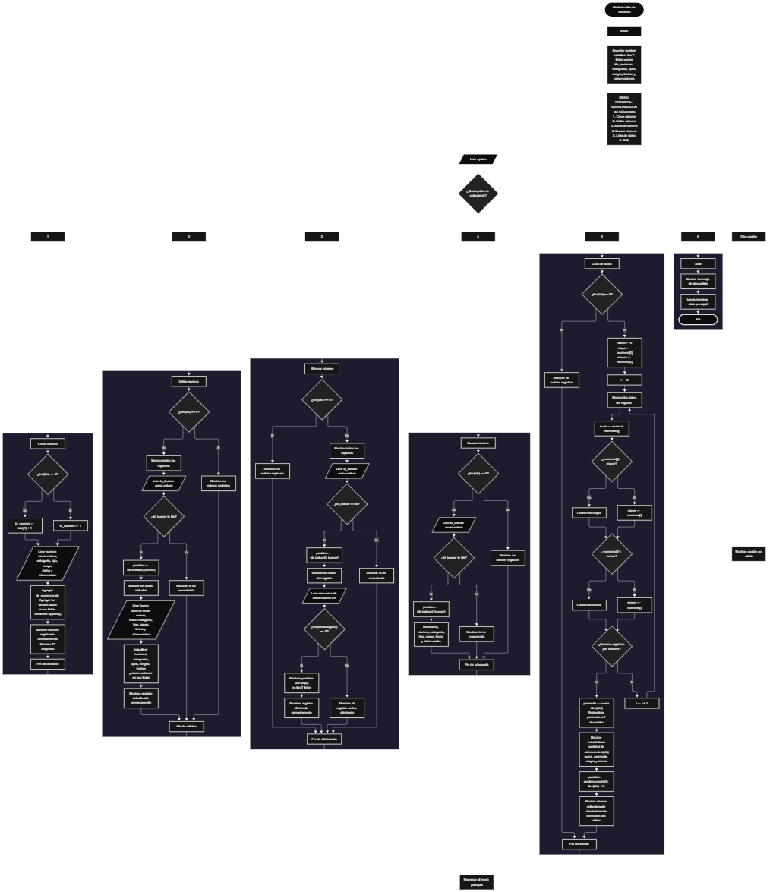

 

Este proyecto, llamado <b>aleatorizador de números</b>, fue desarrollado en <b>python</b> como un ejercicio práctico para fortalecer la lógica de programación mediante la creación de un sistema de gestión de números desde la consola. El programa cuenta con un menú principal de seis opciones que permite <b>crear, editar, eliminar, buscar y listar registros numéricos</b>, además de finalizar la ejecución. Cada registro almacena información como el número entero, su categoría, tipo, rango, fecha y observaciones, utilizando siete listas paralelas para organizar los datos durante la ejecución del programa. También incorpora funciones estadísticas para calcular la suma, el promedio, el número mayor y el menor, junto con un proceso que selecciona aleatoriamente uno de los registros existentes. Durante su desarrollo se aplicaron conceptos fundamentales de programación, como variables, listas, estructuras condicionales, ciclos repetitivos, estructuras de selección, búsqueda por identificador y operaciones aritméticas. Este proyecto permite poner en práctica los conocimientos adquiridos en Python y sirve como base para desarrollar sistemas de gestión numérica más avanzados.

<h2 align="center">⚙️ Funcionamiento del menú principal</h2>

### ➕ Crear número

La opción <b>1) crear número</b> permite registrar un nuevo número junto con sus datos descriptivos. Antes de realizar el registro, el programa comprueba si la lista <b>ids</b> está vacía mediante la condición <b>len(ids) == 0</b>. Si no existen registros, asigna el identificador inicial <b>1</b> a través de la variable <b>id_numero</b>. Si ya existen registros, obtiene el nuevo identificador sumando uno al último elemento de la lista mediante la expresión <b>ids[-1] + 1</b>. A continuación, solicita el <b>número entero, la categoría, el tipo, el rango, la fecha y la observación</b>. La categoría se solicita como positivo, negativo o cero, mientras que el tipo se solicita como par o impar; sin embargo, el programa no comprueba que los valores introducidos correspondan a esas categorías. Los datos se almacenan en las listas <b>ids, numeros, categorias, tipos, rangos, fechas y observaciones</b> mediante el método <b>append()</b>. Finalmente, muestra el mensaje <b>"número registrado correctamente."</b> y presenta el identificador asignado al registro.

### ✏️ Editar número

La opción <b>2) editar número</b> permite modificar la información de un número registrado. Primero, el programa comprueba si existen registros mediante la condición <b>len(ids) == 0</b>. Si no hay datos almacenados, muestra el mensaje <b>"no existen registros."</b>. En caso contrario, presenta una lista con los identificadores, números, categorías, tipos, rangos, fechas y observaciones de los registros disponibles. Después, solicita el identificador que se desea editar y lo convierte a entero mediante <b>int(input())</b>. Para comprobar si el registro existe, utiliza la condición <b>id_buscar in ids</b> y localiza su posición con <b>ids.index(id_buscar)</b>. Si encuentra el identificador, muestra los datos actuales y solicita el nuevo número entero, la nueva categoría, el nuevo tipo, el nuevo rango, la nueva fecha y la nueva observación. Los cambios se aplican directamente a las posiciones correspondientes de las listas, conservando el identificador original. Finalmente, muestra el mensaje <b>"registro actualizado correctamente."</b>. Si el identificador no existe, presenta el mensaje <b>"id no encontrada."</b>.

### 🗑️ Eliminar número

La opción <b>3) eliminar número</b> permite eliminar un registro mediante su identificador. Antes de iniciar el proceso, el programa comprueba si existen registros almacenados. Si las listas están vacías, muestra el mensaje <b>"no existen registros."</b>. Si existen datos, presenta una lista con la información de los números registrados y solicita el identificador que se desea eliminar. Después, comprueba si el identificador está presente en la lista <b>ids</b> y obtiene su posición utilizando <b>ids.index(id_buscar)</b>. Si el registro existe, muestra sus datos y solicita una confirmación mediante la pregunta <b>"¿desea eliminar este registro? (s/n): "</b>. La eliminación se ejecuta cuando la respuesta, convertida a mayúsculas mediante <b>respuesta.upper()</b>, es igual a <b>"S"</b>. En ese caso, utiliza el método <b>pop()</b> para eliminar la misma posición de las siete listas, manteniendo relacionados los datos restantes. Finalmente, presenta el mensaje <b>"registro eliminado correctamente."</b>. Si el usuario no confirma la operación, muestra <b>"el registro no fue eliminado."</b>. Si el identificador no existe, informa mediante el mensaje <b>"id no encontrada."</b>.

### 🔎 Buscar número

La opción <b>4) buscar número</b> permite localizar un registro mediante su identificador. Primero, el programa comprueba si existen datos almacenados. Si no hay registros, muestra el mensaje <b>"no existen registros."</b>. En caso contrario, solicita el identificador que se desea buscar y convierte el valor introducido a entero. Después, utiliza la condición <b>id_buscar in ids</b> para comprobar si el identificador existe. Cuando encuentra una coincidencia, obtiene la posición correspondiente mediante <b>ids.index(id_buscar)</b> y muestra toda la información asociada: identificador, número, categoría, tipo, rango, fecha y observación. Si no encuentra el identificador solicitado, presenta el mensaje <b>"id no encontrada."</b>. Esta operación permite consultar un registro específico sin necesidad de recorrer manualmente toda la lista de datos.

### 📋 Lista de datos

La opción <b>5) lista de datos</b> permite visualizar los registros existentes y calcular estadísticas sobre los números almacenados. Antes de comenzar, el programa comprueba si la lista <b>ids</b> está vacía. Si no existen registros, muestra el mensaje <b>"no existen registros."</b>. Si hay datos disponibles, inicializa la variable <b>suma</b> en cero y establece las variables <b>mayor</b> y <b>menor</b> con el primer elemento de la lista <b>numeros</b>. A continuación, utiliza un ciclo <b>for</b> para recorrer todos los registros, mostrar sus datos y acumular los números mediante la expresión <b>suma += numeros[i]</b>. Durante el recorrido, compara cada número con los valores de <b>mayor</b> y <b>menor</b> para actualizar el número más alto y el más bajo. Al finalizar, calcula el promedio mediante <b>suma / len(ids)</b> y redondea el resultado a dos decimales utilizando <b>round(promedio, 2)</b>. Posteriormente, muestra la cantidad de registros, la suma, el promedio, el mayor número y el menor número. Finalmente, utiliza <b>random.randint(0, len(ids) - 1)</b> para generar una posición aleatoria válida y presentar los datos completos de uno de los registros existentes. De esta manera, la opción combina el listado de datos, el análisis estadístico y la selección aleatoria.

### 🚪 Salir del menú principal

La opción <b>6) salir</b> permite finalizar la ejecución del programa. Cuando el usuario selecciona esta opción, el sistema muestra el mensaje <b>"gracias por utilizar el aleatorizador de números."</b> y ejecuta la instrucción <b>break</b>, que interrumpe el ciclo <b>while True</b> del menú principal. De esta forma, el programa termina su ejecución después de mostrar el mensaje de despedida. Si el usuario introduce una opción diferente de las comprendidas entre <b>1 y 6</b>, el programa muestra el mensaje <b>"opción no válida."</b> y vuelve a presentar el menú principal.

<h2 align="center">🧠 Temas aplicados en el proyecto</h2>

### 📦 Variables

En este proyecto se utilizan variables para almacenar los datos introducidos por el usuario, controlar las posiciones de los registros, localizar identificadores y realizar los cálculos estadísticos. Cada variable cumple una función específica dentro de las operaciones del programa, desde la creación y modificación de los registros hasta la generación de resultados numéricos y la selección aleatoria.

🔢 **Opcion:** Almacena la opción seleccionada por el usuario en el menú principal.

🆔 **Id_numero:** Guarda el identificador que se asigna al crear un nuevo registro.

🔎 **Id_buscar:** Almacena el identificador introducido por el usuario para localizar un registro.

📍 **Posicion:** Indica la ubicación de un registro dentro de las listas paralelas.

🔢 **Numero:** Almacena el número entero que se registra o se utiliza para actualizar un registro.

🗂️ **Categoria:** Guarda la categoría descriptiva introducida para el número.

🔀 **Tipo:** Almacena el tipo indicado por el usuario, correspondiente a par o impar según lo solicitado.

📏 **Rango:** Guarda la información del rango introducida por el usuario.

📅 **Fecha:** Almacena la fecha asociada al registro.

📝 **Observacion:** Guarda las observaciones adicionales del registro.

📊 **Suma:** Acumula los valores numéricos durante el cálculo estadístico.

📈 **Mayor:** Almacena el número más alto encontrado durante el recorrido.

📉 **Menor:** Almacena el número más bajo encontrado durante el recorrido.

🧮 **Promedio:** Guarda el resultado de dividir la suma entre la cantidad de registros.

🔄 **I:** Funciona como índice para recorrer las listas durante el listado y el cálculo de estadísticas.

🎲 **Respuesta:** Almacena la respuesta introducida por el usuario para confirmar o cancelar la eliminación de un registro.

### 🗃️ Listas

En este proyecto se utilizan siete listas paralelas para almacenar la información de los registros numéricos. Cada lista contiene un tipo específico de dato y utiliza la misma posición para representar un mismo registro. Por ejemplo, los datos de un número situado en la posición <b>0</b> se encuentran distribuidos entre <b>ids[0], numeros[0], categorias[0], tipos[0], rangos[0], fechas[0] y observaciones[0]</b>. Esta organización permite recorrer, consultar, modificar y eliminar la información de forma coordinada. Las listas no tienen una capacidad máxima definida en el código, por lo que pueden crecer durante la ejecución según los registros que se agreguen y los recursos disponibles.

🆔 **Ids:** Almacena los identificadores de los registros.

🔢 **Numeros:** Guarda los números enteros registrados.

🗂️ **Categorias:** Almacena las categorías descriptivas de los números.

🔀 **Tipos:** Guarda los tipos indicados para cada número.

📏 **Rangos:** Almacena la información de los rangos.

📅 **Fechas:** Guarda las fechas asociadas a los registros.

📝 **Observaciones:** Almacena las observaciones adicionales.

### 🔀 Estructuras condicionales

En este proyecto se utilizan las estructuras <b>if, elif y else</b> para controlar el menú principal y decidir qué operación debe ejecutarse. También permiten comprobar si existen registros, determinar si un identificador está almacenado, decidir si se debe confirmar una eliminación y comparar los números para identificar el mayor y el menor. Estas condiciones permiten que el programa responda de manera diferente según la información almacenada y las decisiones del usuario.

### 🔄 Estructuras repetitivas

El programa utiliza las estructuras <b>while</b> y <b>for</b> para repetir instrucciones cuando es necesario. El ciclo <b>while True</b> mantiene activo el menú principal hasta que el usuario selecciona la opción de salida y se ejecuta <b>break</b>. Por su parte, el ciclo <b>for</b>, acompañado de <b>range(len(ids))</b>, recorre los registros almacenados para mostrarlos y calcular las estadísticas. Estos ciclos permiten procesar múltiples registros sin tener que escribir instrucciones individuales para cada uno.

### 🎯 Estructuras de selección

La estructura de selección del menú se implementa mediante una cadena de condiciones <b>if, elif y else</b>. El programa compara la variable <b>opcion</b> con los valores de texto del <b>"1"</b> al <b>"6"</b> para ejecutar la operación correspondiente. Cada alternativa dirige el flujo hacia una funcionalidad específica, mientras que la condición <b>else</b> muestra el mensaje <b>"opción no válida."</b> cuando la selección no coincide con ninguna de las opciones disponibles.

### 🔍 Búsqueda por identificador

La búsqueda de registros se realiza mediante la pertenencia a una lista y la localización de posiciones. La expresión <b>id_buscar in ids</b> comprueba si el identificador se encuentra almacenado, mientras que <b>ids.index(id_buscar)</b> permite obtener la posición del registro correspondiente. Esta posición se utiliza posteriormente para consultar o actualizar los datos de las demás listas, manteniendo la relación entre el identificador y la información asociada.

### 🔢 Conversión de datos

El programa utiliza la función <b>int()</b> para convertir a números enteros los valores introducidos en el campo numérico y en las búsquedas por identificador. Esto permite realizar comparaciones y operaciones aritméticas con los números registrados. Sin embargo, el código no incorpora un manejo de errores para las entradas que no puedan convertirse a enteros, por lo que una entrada no numérica puede interrumpir la ejecución.

### 🧮 Operaciones aritméticas

El proyecto aplica operaciones aritméticas para analizar los números registrados. La suma se obtiene acumulando cada valor durante el recorrido de la lista. El promedio se calcula dividiendo la suma entre la cantidad de registros. Además, las comparaciones numéricas permiten identificar el valor mayor y el menor. Finalmente, la función <b>round()</b> redondea el promedio a dos decimales para presentar un resultado más fácil de interpretar.

### 🎲 Selección aleatoria

El programa importa el módulo <b>random</b> para seleccionar aleatoriamente uno de los registros almacenados. Mediante la instrucción <b>random.randint(0, len(ids) - 1)</b>, genera un número entero dentro del intervalo que corresponde a los índices válidos de las listas. La posición obtenida se utiliza para mostrar el identificador, el número y todos los campos descriptivos del registro seleccionado. Esta operación se realiza únicamente cuando existen registros, evitando generar una posición aleatoria sobre una lista vacía.

<h2 align="center">¿Cómo se implementaron las operaciones crud en el proyecto?</h2>

Las operaciones <b>crud</b> se implementaron mediante las opciones del menú principal, permitiendo administrar los registros numéricos durante la ejecución del programa. La operación <b>crear</b> corresponde a <b>crear número</b>, donde se introducen los datos de un nuevo registro y se almacenan en las listas paralelas. La operación <b>leer</b> se realiza mediante <b>buscar número</b> y <b>lista de datos</b>, que permiten consultar un registro específico o visualizar todos los registros junto con sus estadísticas. La operación <b>actualizar</b> corresponde a <b>editar número</b>, donde se modifican los datos de un registro existente sin cambiar su identificador. Finalmente, la operación <b>eliminar</b> se realiza mediante <b>eliminar número</b>, que solicita confirmación antes de retirar la información de las siete listas. Estas operaciones se apoyan en variables, listas, condiciones, ciclos y métodos integrados de Python.

<h2 align="center">Diagrama de flujo del proyecto</h2>

<h2 align="center">🛡️ Validaciones del programa</h2>

### 📭 No existen registros

Esta comprobación se utiliza en las opciones de <b>editar, eliminar, buscar y lista de datos</b>. El programa verifica si la lista <b>ids</b> está vacía mediante la condición <b>len(ids) == 0</b>. Cuando no existen registros, muestra el mensaje <b>"no existen registros."</b> y evita continuar con las operaciones que necesitan información almacenada. Esta comprobación también evita acceder al primer elemento de la lista <b>numeros</b> o calcular estadísticas cuando no hay datos disponibles.

### 🔎 Identificador no encontrado

Esta comprobación se utiliza durante las operaciones de edición, eliminación y búsqueda. El programa verifica si el identificador introducido se encuentra en la lista <b>ids</b> mediante la condición <b>id_buscar in ids</b>. Si existe, obtiene su posición con <b>ids.index(id_buscar)</b> y continúa con la operación solicitada. Si no existe, muestra el mensaje <b>"id no encontrada."</b>, evitando realizar modificaciones o eliminaciones sobre un registro inexistente.

### 🗑️ Confirmación de eliminación

Antes de eliminar un registro, el programa solicita una respuesta mediante la pregunta <b>"¿desea eliminar este registro? (s/n): "</b>. La condición <b>respuesta.upper() == "S"</b> permite confirmar la operación tanto con la letra <b>s</b> como con la letra <b>S</b>. Si la condición se cumple, elimina los datos de la posición correspondiente en las siete listas. Si no se cumple, muestra el mensaje <b>"el registro no fue eliminado."</b> y conserva los datos. Cualquier respuesta distinta de <b>"S"</b>, después de convertirse a mayúsculas, sigue la ruta de cancelación.

### 🔢 Entrada de números enteros

El programa utiliza <b>int(input())</b> para recibir el número que se registra y los identificadores utilizados en las operaciones de edición, eliminación y búsqueda. Esta conversión permite trabajar con valores enteros, pero no existe una validación que capture errores cuando el usuario introduce letras, símbolos u otros valores que no puedan convertirse a un entero. Por lo tanto, el programa requiere que estos campos se introduzcan con un formato numérico válido para continuar normalmente.

### ⚠️ Categoría y tipo del número

Durante la creación del registro, el programa solicita una categoría correspondiente a <b>positivo, negativo o cero</b> y un tipo correspondiente a <b>par o impar</b>. Sin embargo, estos campos se almacenan como texto y no se comprueba si coinciden con las opciones indicadas. El programa tampoco calcula automáticamente la categoría o el tipo a partir del número introducido. Por ello, la información guardada depende de los valores proporcionados por el usuario.

### 🆔 Asignación de identificadores

El programa asigna el identificador inicial <b>1</b> cuando no existen registros y, en caso contrario, utiliza el último identificador almacenado más uno mediante <b>ids[-1] + 1</b>. Este procedimiento funciona con el orden habitual de creación de registros, pero no garantiza que los identificadores sean siempre únicos a lo largo de toda la ejecución. Si se elimina el último registro y se crea otro posteriormente, el identificador eliminado puede volver a utilizarse, ya que el programa no mantiene un contador independiente de identificadores.

### 💾 Almacenamiento temporal

Los registros se almacenan en las listas de Python durante la ejecución del programa. No se utilizan archivos, bases de datos ni otros mecanismos de persistencia. Por esta razón, los datos se mantienen disponibles mientras el programa continúa ejecutándose, pero no se conservan automáticamente después de finalizar la ejecución.

### ⚠️ Opción inválida

La última condición de la estructura de selección del menú utiliza <b>else</b> para detectar las entradas que no coinciden con las opciones disponibles. Cuando el usuario introduce un valor distinto de <b>1, 2, 3, 4, 5 o 6</b>, el programa muestra el mensaje <b>"opción no válida."</b>. Después, el ciclo principal continúa y vuelve a presentar el menú para permitir una nueva selección.

<h2 align="center">🎯 Objetivo del proyecto</h2>

El objetivo principal de este proyecto es fortalecer la <b>lógica de programación</b> mediante el desarrollo de un sistema de gestión de números en <b>python</b>. A través de su construcción se busca aplicar los conocimientos adquiridos sobre variables, listas, estructuras condicionales, ciclos repetitivos, búsqueda por identificador y operaciones aritméticas, integrándolos para resolver un problema de manera organizada. Además, el proyecto permite comprender cómo registrar, consultar, modificar y eliminar datos, calcular estadísticas básicas y utilizar herramientas de generación aleatoria en una aplicación de consola. De esta manera, constituye una base para desarrollar programas más completos que incorporen validaciones, almacenamiento persistente y nuevas funcionalidades.

